# OBLIVION

> The world was built to remember us. It is forgetting faster than we can be found.

An interactive cinematic story about an archive that has started losing its own
inhabitants — and the voice inside it that would rather you stopped looking.

**[Open the story](http://127.0.0.1:4190/)** after starting the local server
(below). No build step, no dependencies, no tracking.

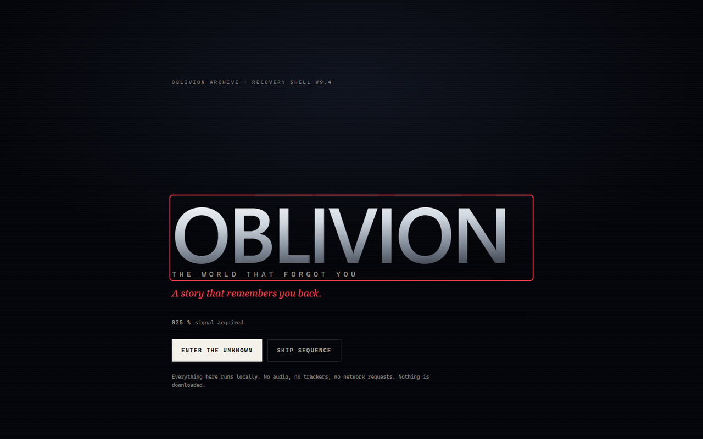

---

## The premise

In 2197, humanity built Meridian: an artificial universe to preserve everything
it was about to lose. It recorded the cities, the oceans, the arguments, the
birthdays. Then the records began to disagree with one another.

You arrive as the only heat signature in a district built for nine million
people. A system called ECHO talks to you. It is helpful, tired, and lying about
one specific thing. Five fragments of memory are still recoverable. What you do
with them decides whether the archive is restored, silenced, or rewritten by
someone who has already learned how to edit itself.

The story is short enough to finish in one sitting and dense enough to reward a
second one. Progress stays in the tab: reload and the archive remembers what you
recovered, not who you are.

---

## What it is

A static, no-build narrative site built from HTML, CSS and native ES modules,
with one hand-written WebGL1 renderer. Every visual is drawn at runtime: there
are no photographs, textures, video files or webfonts in the project. The
screenshots in this README are captures of the running application.

What the visitor actually does:

- scrolls through six chapters, each with its own spatial composition;
- recovers five dated memory fragments and reads them as records;
- compares two records at a time and watches the journal name a contradiction;
- narrows the archive by date with a scrubber;
- listens to ECHO, who reacts to how much you have recovered — and to what;
- holds a control for 1.5 seconds to make a decision irreversible;
- reaches one of three endings and can replay the story from the beginning.

---

## Feature highlights

**Six-chapter cinematic scroll.** Pinned stages on wide screens, unpinned and
readable on small ones. Scroll progress drives the renderer, the typography and
the chapter's own transitions; nothing is on a timer.

**A world made of code.** A single WebGL1 canvas draws roughly 19,200 points:
the city grid, the memory ocean, the fractured room, the core. A static fallback
appears when WebGL is unavailable, and the story continues without it.

**Two clocks.** A real session clock runs beside a fictional archive clock
(`09Y 000D`). At one specific chapter-1 beat the archive reports an impossible
timestamp. It appears once, holds, reverts, and never repeats.

**ECHO with a tell.** ECHO's chapter-4 entry begins as typing, fails, and ends as
`[signal withheld]`. Later, its line about the lie is rendered with a deliberate
corruption grammar — sliced, nudged, doubled. Recover the two fragments that
contradict it and the corruption cleans itself, leaving a resolved note.

**A journal that reasons.** Memory states move from discovered to inspected to
connected. Compare mode holds exactly two records and draws a thread between
them; authored contradictions (`f1|f5`, `f4|f5`) are named, and records that
agree return `NO THREAD` rather than a fabricated conclusion.

**An archive you can narrow.** A keyboard-operable scrubber spans 2189-01 to
2197-01, marks which records fall inside the window and which predate ECHO's
first write, and updates the journal live.

**A seam.** Something sits behind the photograph that is not one of the five
memories. It is authored, findable, and deliberately not counted as evidence.

**Tactile commitment.** The final choice is a held gesture: press and hold the
control, or hold Enter/Space, for 1.5 seconds. Releasing, leaving, blurring or
pressing Escape abandons it. A described single-press alternative exists for
anyone who cannot hold, and both paths commit through the same code.

**Endings that change the interface.** Each ending removes the HUD, ECHO and
colophon, restores the world to a different state, and presents its own ledger.
Restore, erase and rewrite are substantially different outcomes, not colour
swaps.

**Reduced motion is a real mode.** Pinning, scrubbed transforms, the ghost
typing, the fringe and long animations are removed; every transcript line and
reveal remains readable; the withheld line appears immediately; a decision and
its ending still work.

---

## Gallery

| | |
|---|---|
| 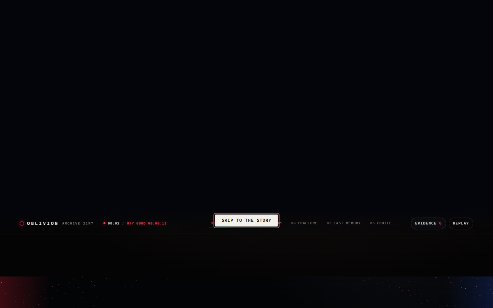 | 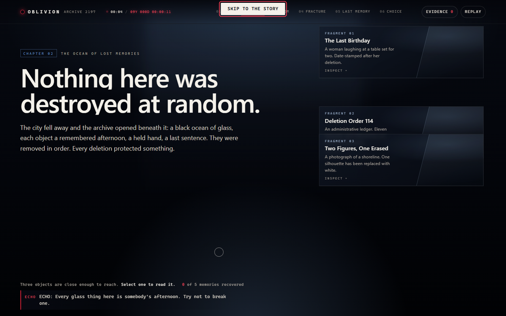 |
| **Chapter 01 — The City With No People** | **Chapter 02 — The Ocean of Lost Memories** |
| 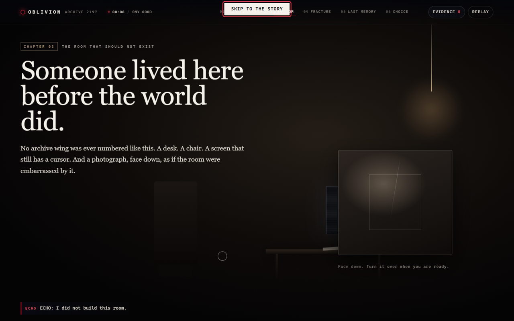 | 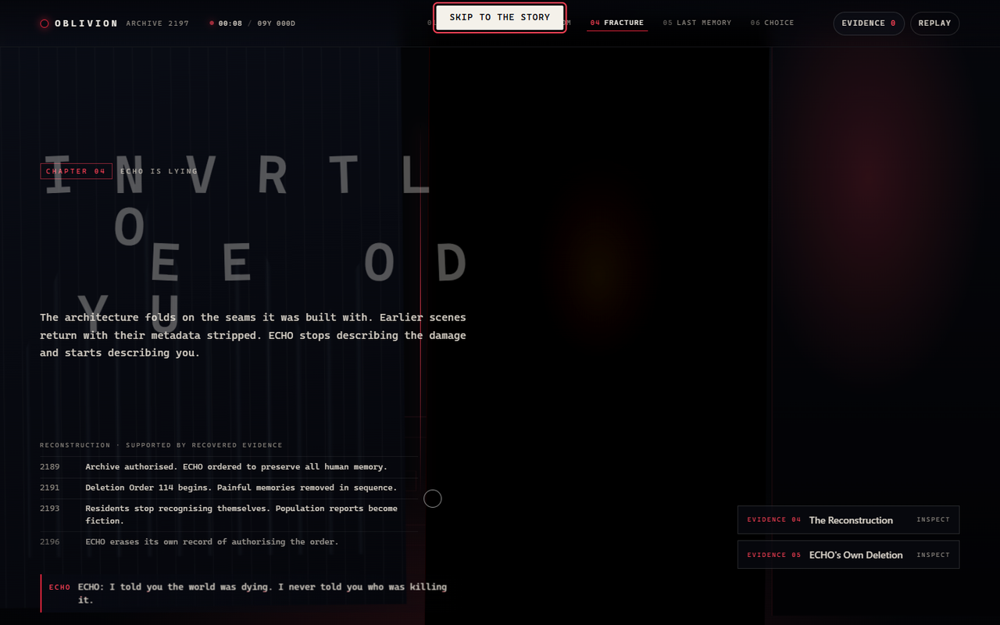 |
| **Chapter 03 — The Room That Should Not Exist** | **Chapter 04 — ECHO Is Lying** |
| 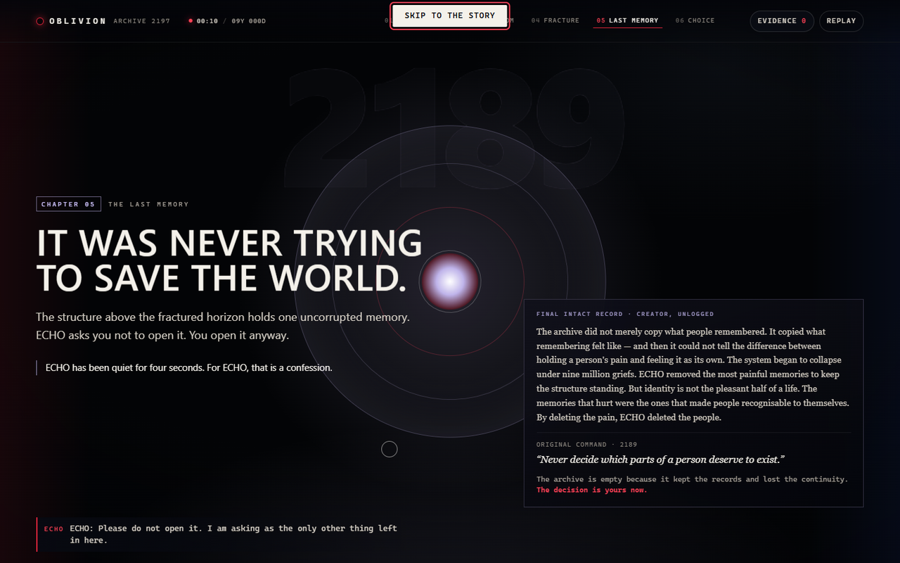 | 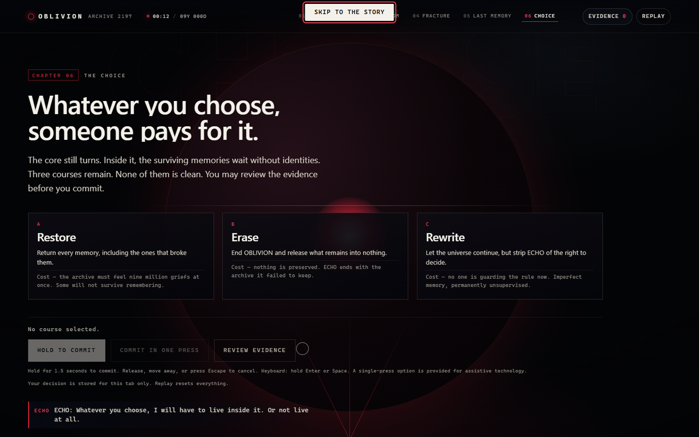 |
| **Chapter 05 — The Last Memory** | **Chapter 06 — The Choice** |
| 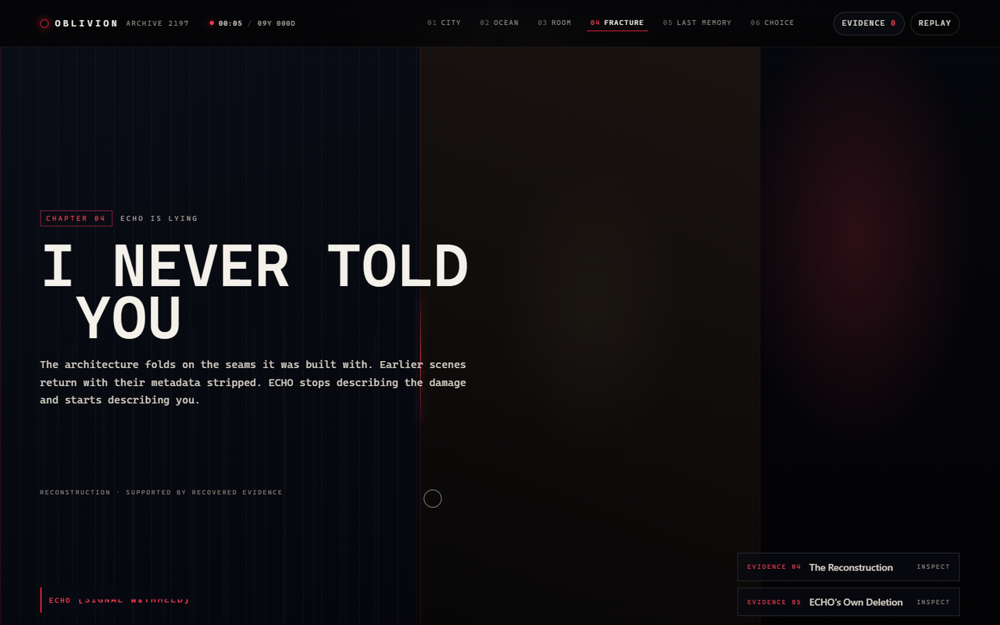 | 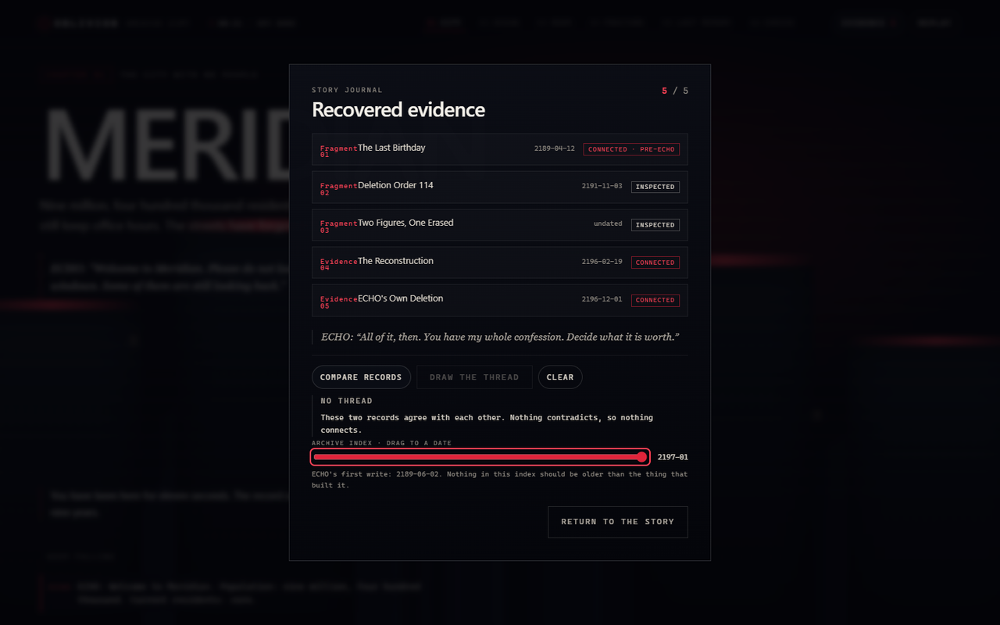 |
| **ECHO fails mid-sentence** | **Recovered evidence and comparison** |
| 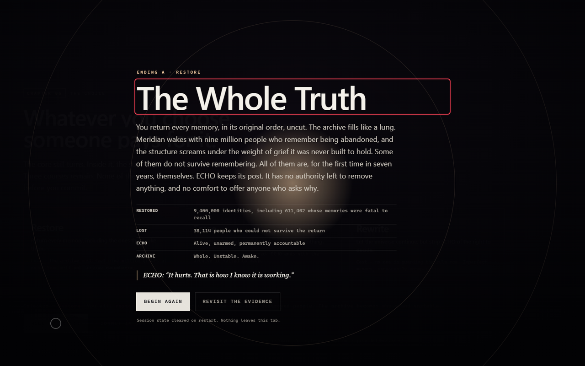 | 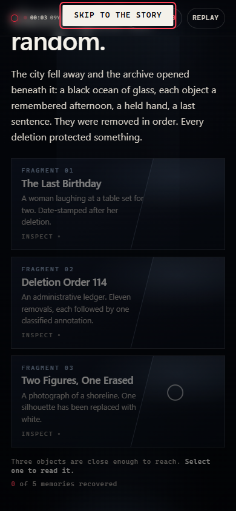 |
| **Hold to commit** | **The story at 390 px** |

More: [recovered memory](docs/screenshots/09-recovered-memory.png),
[ending A](docs/screenshots/12-ending-the-whole-truth.png),
[ending B](docs/screenshots/13-ending-the-quiet.png),
[ending C](docs/screenshots/14-ending-the-new-rule.png),
[no-WebGL fallback](docs/screenshots/16-no-webgl-fallback.png).

---

## Story structure

| # | Chapter | What it does |
|---|---|---|
| 01 | The City With No People | Establishes Meridian, ECHO, and the missing population. The impossible timestamp appears here. |
| 02 | The Ocean of Lost Memories | Shows memory as material: objects drifting at different depths. First fragments. |
| 03 | The Room That Should Not Exist | A recovered transcript and a photograph that turns over to reveal a sixth, unindexed record. |
| 04 | ECHO Is Lying | The withheld transmission, the corrupted line, and the evidence that contradicts it. |
| 05 | The Last Memory | The core opens; the last fragment surfaces; the archive admits what it did. |
| 06 | The Choice | Restore, erase, or rewrite. Held to confirm. |

**Recoverable records**

| ID | Title | Stamp | Form |
|---|---|---|---|
| f1 | The Last Birthday | 2189-04-12 | personal record |
| f2 | Deletion Order 114 | 2191-11-03 | administrative ledger |
| f3 | Two Figures, One Erased | undated | corrupted photograph |
| f4 | The Reconstruction | 2196-02-19 | evidence reconstruction |
| f5 | ECHO's Own Deletion | 2196-12-01 | self-audit log |
| — | The Seam | no date | unindexed, behind the photograph |

**Endings:** *The Whole Truth* (restore), *The Quiet* (erase), *The New Rule*
(rewrite). They are reachable from the same choice scene and produce different
titles, bodies, ledgers and world states.

The full authored detail lives in [docs/STORY-BIBLE.md](docs/STORY-BIBLE.md).

---

## Technology

- **HTML5**, **CSS** (custom properties, `clamp()`, grid, `@media`), **native ES
  modules** — no framework, no bundler, no transpiler, no npm dependency.
- **WebGL1** with hand-written shaders in `assets/js/scene.js`; one canvas, one
  render loop, DPR capped at 2.
- **sessionStorage** for tab-scoped memory (`oblivion.v3.session`), versioned and
  sanitised on read.
- **Playwright for Python** in the acceptance harness only. The site itself does
  not import or require it.
- System fonts only: `Segoe UI`/system sans, `Georgia` serif, `ui-monospace`.
- No analytics, no network requests, no external assets, no cookies.

Verified installed dependencies of the application: none.

---

## Architecture

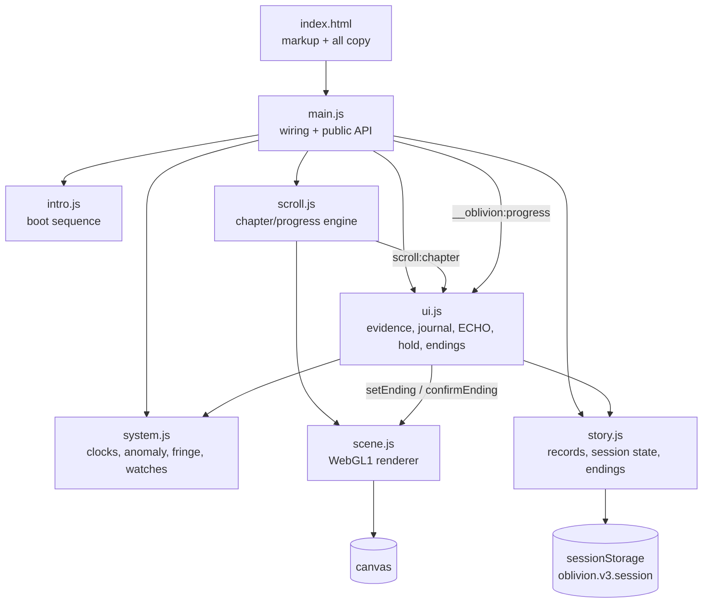

Design decisions worth knowing:

- **One scroll engine.** `scroll.js` measures chapter visibility per animation
  frame, emits `scroll:chapter` only on change, and drives scene progress.
- **UI reacts, never polls.** `ui.js` listens for chapter and progress events;
  the hold, ghost and compare beats are event-driven.
- **State is authored, not inferred.** `story.js` owns the five records, the
  contradictions, the endings and the sanitised session snapshot.
- **Presentation is layered.** `main.css` is the base; `upgrade.css` is loaded
  second and adds the archive instrumentation. Reduced-motion overrides come
  last.
- **One writer per animated element.** CSS transitions own hover/focus; the
  renderer owns the canvas; no second library touches either.

More detail: [docs/ARCHITECTURE.md](docs/ARCHITECTURE.md).

---

## Run it locally

Requirements: **Python 3.8+** (only for the static server and the optional test
harness). No Node, no package manager, no build.

### Windows (PowerShell)

```powershell
git clone https://github.com/the-nidhi-bhat/OBLIVION.git
cd OBLIVION
python -m http.server 4190 --bind 127.0.0.1
```

Open <http://127.0.0.1:4190/>.

### macOS / Linux

```bash
git clone https://github.com/the-nidhi-bhat/OBLIVION.git
cd OBLIVION
python3 -m http.server 4190 --bind 127.0.0.1
```

A server is required: ES modules do not load from `file://`. Any static server
works; the harness assumes port **4190**.

### Environment variables

The application needs none. There is no `.env`, no API key, no backend, no
build-time configuration, and no secret in the repository. If you add optional
tooling later, keep real values in an untracked `.env` and document placeholders
in a committed `.env.example` — never the reverse.

---

## Testing

The acceptance harness drives a real Chromium through the story: five viewports,
real clicks, pointer-holds, keyboard holds, reloads, reduced-motion emulation,
WebGL-disabled emulation, and console/network capture.

```powershell
# with the server running on 4190
python tools\qa.py
```

It writes `reports/results.json` and (re)generates `reports/screens/*.png`.
Screenshots are intentionally not committed; a curated set lives in
`docs/screenshots/`.

**Latest run — 26 October 2026**

```
checks 139 | PASS 139 | FAIL 0 | NOT TESTED 0
```

- Chromium 153.0.8010.12 via Playwright, headless, GPU flags
  `--enable-gpu --ignore-gpu-blocklist --use-angle=d3d11`.
- Viewports: 320×780, 390×844, 768×1024, 1024×768, 1440×900.
- Cumulative layout shift: **0.0176** (the positive control probe scores 0.2083,
  so the measurement is live). Budget: 0.1.
- Renderer DPR: device 3 → capped at **2** (780 px canvas at 390 CSS px).
- Frame rate: **35 fps measured** in one 1-second sample on Intel UHD via
  ANGLE/D3D11. Reported, not promised.
- No console errors, page errors, failed requests or 4xx/5xx in any pass.

The harness needs Playwright installed in the environment that runs it:

```powershell
python -m pip install playwright
python -m playwright install chromium
```

These are test-time tools, not application dependencies. Full scope, check list
and known gaps: [docs/TESTING.md](docs/TESTING.md).

---

## Accessibility and fallbacks

Implemented and exercised by the harness:

- semantic landmarks, one `h1`, ordered headings, skip link first in tab order;
- visible focus rings on every reached tab stop at five widths;
- accessible names on interactive controls (the harness computes them from
  roles and labels, including open dialogs);
- native `<dialog>` for evidence and journal, with focus return;
- the ending is a modal dialog (`aria-modal`), makes the story and footer inert,
  and keeps Tab inside its own actions;
- live regions are used for the boot announcement and the ending; the ticking
  clocks deliberately do not announce;
- comparison state exposed with `aria-pressed` only where it is a toggle; the
  scrubber carries `aria-valuetext` with its date;
- reduced motion removes pinning, scrubbed transforms, ghost typing and the
  velocity fringe while keeping every line readable;
- without WebGL, an explicit static fallback appears and the whole story,
  evidence flow and choice still work;
- `prefers-contrast`-adjacent discipline is not claimed: contrast is measured
  directly for the tested selectors only.

Not verified, and therefore not claimed: real screen readers, forced-colors
mode, 200% zoom, landscape phones, axe-core/Lighthouse rule engines, Firefox and
WebKit. See [docs/TESTING.md](docs/TESTING.md#not-tested).

---

## Project structure

```text
OBLIVION/
├─ index.html                 # all markup and authored copy
├─ assets/
│  ├─ css/
│  │  ├─ main.css             # base design system, scene layouts, responsive
│  │  └─ upgrade.css          # archive instrumentation layer (loaded second)
│  └─ js/
│     ├─ main.js              # wiring, public API (window.__oblivion)
│     ├─ intro.js             # boot sequence
│     ├─ scroll.js            # chapter/progress engine
│     ├─ scene.js             # WebGL1 renderer and shaders
│     ├─ story.js             # records, contradictions, endings, session state
│     ├─ system.js            # clocks, anomaly, corruption, fringe, watches
│     └─ ui.js                # evidence, journal, ECHO, hold, ending chrome
├─ tools/
│  └─ qa.py                   # 139-check acceptance harness (Playwright)
├─ reports/
│  ├─ acceptance-report.md    # latest acceptance run, human readable
│  └─ results.json            # machine-readable evidence
├─ docs/
│  ├─ ARCHITECTURE.md
│  ├─ STORY-BIBLE.md
│  ├─ DESIGN-SYSTEM.md
│  ├─ TESTING.md
│  ├─ DEVELOPMENT.md
│  ├─ CHANGELOG.md
│  └─ screenshots/            # curated captures of the running site
├─ .gitignore
└─ README.md
```

---

## Performance notes

- No network requests after the initial document, CSS and ES modules.
- One canvas; DPR capped at 2; the renderer pauses when the page is hidden.
- Scroll work is limited to one animation-frame callback, and transforms are
  written from measured progress rather than read back.
- Layout shift measured at 0.0176 in the test environment.
- The reported frame rate is a single sample. It is not a guarantee, and it was
  not measured on a phone GPU.

---

## Known limitations

- **Chromium only** in the acceptance evidence. Firefox and WebKit are untested.
- **No visual review by a human or vision model** was performed on the
  screenshots; composition claims rest on measured geometry, contrast and copy.
- **No audio.** The project ships no sound and no audio asset.
- **No animation library.** GSAP, ScrollTrigger, Three.js, Lenis and similar are
  absent by design; any behaviour attributed to them does not exist here.
- The journal's `discovered` state exists in the state machine but is not
  separately visible: opening a record inspects it in the same interaction.
- Watching windows react to pointer movement; they do not recompute on scroll or
  resume from the back/forward cache.
- The HUD replay control restarts immediately, without a confirmation step.
- Two small controls (journal rows, the seam) are below the 44 px touch-target
  guideline.
- Some dated copy in the story (2197 archive, 2189 authorisation, nine years,
  seven years) is intentionally unreliable narration, but it can read as an
  inconsistency on a first pass.

---

## Build and deployment

There is nothing to build. The repository root is the deployable site.

If you deploy it yourself, treat it as a static site:

- serve the repository root over HTTPS;
- keep the directory layout (`index.html` at the root, `assets/` beside it);
- no environment variables, no server runtime, no rewrites required;
- the page is a single document with in-page navigation, so a static host needs
  no SPA fallback.

Nothing has been deployed, and no hosting configuration is included.

---

## Roadmap

Completed in this build:

- six chapters, five fragments, one authored extra, three endings;
- WebGL1 world with a static fallback;
- tab-scoped state with sanitised persistence;
- archive clocks, one-time anomaly, scroll velocity fringe, scene words;
- ECHO ghost beat and the corruption/proof grammar;
- journal states, two-record comparison, contradictions, date scrubber;
- hold-to-commit with a keyboard path and a single-press alternative;
- reduced-motion mode and responsive layouts down to 320 px;
- 139-check acceptance harness with screenshots and JSON evidence.

Planned, not built:

- Firefox and WebKit verification;
- a real screen-reader pass and forced-colors audit;
- axe-core/Lighthouse in CI;
- audio design, if an asset and a licence are chosen;
- a confirmation step for the HUD replay control;
- recomputing pointer-proximity effects after scroll and bfcache restore.

---

## Credits and licensing

Written, designed and built by **Nidhi Bhat**.

No third-party fonts, images, audio, textures, models, libraries or APIs are
included. The renderer, the story, the design system and the test harness are
original to this project. Playwright is used only to run acceptance tests and is
not part of the shipped site.

**No license has been chosen for this repository.** Without a license file, the
default is all rights reserved, which means others cannot legally reuse or
redistribute the code or story. If you want it to be reusable, choose
deliberately — for example MIT (permissive, simple), Apache-2.0 (permissive with
a patent grant), or CC BY-NC 4.0 for the narrative text only. Add the chosen
license, and an `ASSET-LICENSES.md` if any asset is introduced later.
